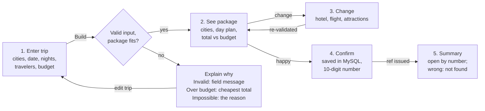
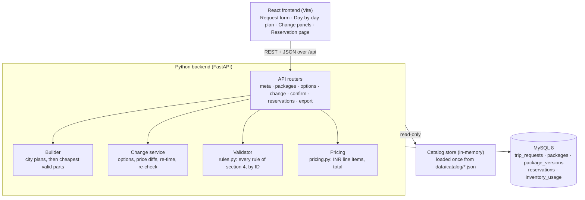

# PRD — Build My Holiday (Hackathon Problem 1)

Nov 13, 2026 · Shivang Verma

## 1. Overview

Build My Holiday is a web app that turns 7 inputs into one complete, rule-valid holiday package. The package covers flights, hotels, airport transfers, inter-city transfers and attractions. The app re-validates the whole package after every change and books it under a 10-digit reservation number. Stack: React frontend, Python (FastAPI) backend, MySQL database.

**Goal for the event:** every Must feature (M1–M8) works end-to-end, and every package the app outputs passes all section-4 rules on requests the judges have not seen. Good-to-have and Stretch features come only after that.

**Success metrics**

- 100% of exported packages pass the judges' rule checker. A package that breaks one rule counts as wrong.
- The Menon request (BLR → Japan, 10 Apr 2027, 6 nights, 2A + 1C age 6, ₹3,50,000) builds in under 3 seconds and fits the budget.
- Unseen requests (other departure city, UAE, other dates, group sizes, budgets) return one of four clear outcomes: a package, over budget (M8), impossible with a reason (M2), or invalid input (M1).
- Reservations survive a backend restart, and a wrong number shows "not found".

**Judging weights:** end-to-end features 25% · correctness on judge requests 25% · individual understanding 20% · product and UX 15% · engineering quality 15%. Correctness is the core: one shared rule validator, used by the builder, every change and the export, is what scores the points.

## 2. Users and problem

The primary user is a traveler planning a multi-city holiday abroad who cannot check by hand that every part fits.

| User | Who | What they need |
| --- | --- | --- |
| Primary persona | Menon family, Bengaluru: 2 adults, 1 child (6). First trip to Japan, ₹3,50,000 for everything | Cities chosen for them, a package that just works, the freedom to swap a hotel or attraction without breaking anything |
| Any traveler | Other departure cities, Japan or UAE, 3–10 nights, any group size and budget | The same guarantees on any valid request, and a clear reason when no package is possible |
| Judge (evaluator) | Enters unseen requests and changes, exports the JSON into a rule checker | Every rule true, prices within 1%, honest failure messages, a persistent reservation |

**Why it is hard today.** Each part has its own constraints: airports serve only some cities, transfers run in service hours, attractions close on some days, and seats and rooms run out per night. These parts depend on each other, so one change (a later flight, say) can break the pickup time, the first day's attraction or the budget. Agents fix this by hand, fixed packages stop you from changing anything, and DIY planning leaves all the cross-checking to the traveler.

**Product promise:** a correct package within budget when one exists, kept correct after every change. When no package fits, the app says exactly why.

## 3. Scope

We build in strict priority order. A Good or Stretch feature starts only after all 8 Must features pass the rule checker on 5+ test requests.

| Tier | Features | Priority |
| --- | --- | --- |
| Must | M1 request form · M2 build one package · M3 all rules respected · M4 day-by-day plan · M5 total, budget, JSON export · M6 change hotel, flight, attractions · M7 confirm + 10-digit reservation · M8 budget too small | P0, hours 0–7 |
| Good | G2 price difference on each option · G1 fix or warn about knock-on effects · G4 cheapest, fastest, best-rated packages · G3 change cities | P1, in that order, hours 7–9 |
| Stretch | S2 booking consumes seats and rooms · S1 rule-based quick request parser · S3 own idea (e.g. printable itinerary) | P2, only if time remains |

**Out of scope:** login, payments, real supplier booking, online deployment, editing catalog files, any AI or LLM call inside the app, mobile apps, multi-currency (everything is INR).

**Why G2 and G1 first among the Good features:** they reuse the M6 change endpoint (cost about 1 hour) and are visible in the demo. G4 needs the builder to run 3 objectives; G3 needs a city-plan picker UI.

## 3a. What the catalog data tells us

The data is small and full of traps. The search space is tiny (at most 135 city plans per request), but timing windows, low seat counts and zero-valued prices decide whether a package is valid. Figures below come from the data pack (DATA\_DICTIONARY.md and `data/catalog/`), checked with a quick prototype script.

| Area | What the data says | Design impact |
| --- | --- | --- |
| Cities | Japan: Tokyo, Kyoto, Osaka; all 6 ordered pairs linked by train. UAE: Dubai, Abu Dhabi; linked by bus and taxi both ways. `rules` block gives min 3 / max 10 nights, min 2 nights per city, window 1–20 Apr | Japan max 3 cities, UAE max 2. Full enumeration is cheap. Read limits from `destinations.json.rules`, never hard-code |
| Airports | Kyoto has no airport: KIX serves Osaka and Kyoto. DXB serves Dubai and Abu Dhabi. ITM has `serves_cities: []`. Indian airports have no `serves_cities` field | First and last city come from `serves_cities`, never from `airports.city`. Treat a missing field as an empty list |
| Flights | 469 records: 240 outbound, 229 return. 460 direct, 9 one-stop (all BLR → Japan). Outbound departures start 31 Mar (landing 1 Apr); returns can land on 21 Apr | Filter outbound by the date of `arrival_local`, return by the date of `departure_local`. Never filter by the other end |
| Seats | `seats_left` runs 1–9. Four flights have ≤ 2 seats, e.g. FL-403 BLR → HND on 10 Apr has 2 seats (a trap for the 3-person Menon family) | Any group of 10+ travelers can never get a package: catch it at M1 with a clear message |
| Routes per day | Not every route flies every day. Example: DEL → Japan landing 10 Apr exists only into HND | "No package" reasons must name the route and date |
| Flight times | Outbound landings run 04:45–22:50 local. FL-405 (BLR → NRT, 10 Apr) lands 21:30, so only a taxi (until 23:00) works. Returns depart 10:00–22:00 | Early returns (10:00–11:00) need a hotel pickup around 06:00, which often falls outside bus hours |
| Durations | `duration_minutes` includes stops. Local-time difference is wrong across zones (IST +5:30, JST +9:00, GST +4:00) | G4 "fastest" uses `duration_minutes` of 2 flights + inter-city transfers only |
| Rooms | 125 room types: TWIN 48, FAMILY (2A+2C) 31, SINGLE 14, FAMILY\_SUITE (4A+2C) 12, DOUBLE 11, TRIPLE 9. Price ₹2,576–61,830 per night, fixed per room type | One price per room type; availability gives only `rooms_left` |
| Availability | 2,500 room-nights, 61 of them sold out (`rooms_left` 0). Max 8 rooms left on any night | One sold-out middle night kills a room type for the whole city stay |
| Transfers | 66 records. Windows use `24:00` and can pass midnight (KIX → Namba shuttle 06:00–00:30). UAE taxis run 24 h; Japan taxis 06:00–23:00 (HND 05:00–24:00). `area: null` serves the whole city (KIX → Kyoto, DXB → Abu Dhabi, AUH bus). Taxis seat 4, the one van 8, buses and trains 99 | A shared time-window helper with wrap-around. Five or more travelers need 2 taxis (PER\_VEHICLE) |
| Inter-city | Trains and intercity buses run every `frequency_minutes` (30) from `service_from`. Tokyo ↔ Kyoto 135 min, Tokyo ↔ Osaka 150 min, Kyoto ↔ Osaka 15 min. Only the UAE taxi is door to door | Departure times must sit on the 30-minute grid. City taxis to stations are optional |
| Attractions | 56 records. 24 are free (price 0). 5 have `child_price` amount 0 (free for kids), which is not the same as a missing `child_price`. Visits run 30–480 min. Some open 00:00–24:00. 11 skip a weekday; 4 have `closed_dates` (ATT-TYO-006 is closed 10–20 Apr). 2 are in Nara, which has no hotels | Never use `child_price or price` on the amount (0 is valid). Exclude Nara. A 10-night stay in Abu Dhabi (7 attractions) or Osaka (9) cannot fill every full day: that plan is invalid |
| Budget baseline | Menon, cheapest prices before paid attractions: 1 city (Tokyo) ₹2,19,324; 2 cities ₹2,30,440; 3 cities (Tokyo → Kyoto → Osaka) ₹2,31,924 | All fit ₹3,50,000. Extra cities cost only about ₹11k–13k, so the city rule can favour variety |
| Export | Shared trip format: `trip_id`, `traveler{name, home_airport, adults, children, child_ages}`, `start_date`, `end_date`, `country`, `budget_inr`, `total_inr`, `items[]`. Items need `item_id`, `type`, `name`, `city`, `status`, `catalog_id`, `start`, `end`, `room_id`, `quantity`, `price_inr`, `booking`, `sources` (always `[]`), `warnings` | `end_date` = return day. Flight `city` = arrival city. Times without seconds (`YYYY-MM-DDTHH:MM`) |

## 4. User journey



The build decision has three failure exits: invalid input (M1), over budget (M8) and no package (M2). Each one returns the traveler to the form with a specific message. Changes loop through the validator, and a refused change leaves the package as it was.

**Screens (3 routes)**

- `/` — request form, with the S1 quick-request box above it. On submit it shows a loader, then routes to the package or to the explain-why panel.
- `/package/:id` — city plan header, budget bar (total, budget, left or over), a day-by-day timeline, and a change drawer per item with options, price diffs and warnings. It also has Export JSON and Confirm. Reloading the page restores state from the API.
- `/reservation/:ref` — a read-only summary from the frozen snapshot, plus a lookup box. A wrong number shows "Reservation not found".

## 5. Functional requirements

Each feature has a testable acceptance criterion. "Validator" means the single backend function `validate(package) -> list[Violation]` described in section 6.

| ID | Requirement | Acceptance criteria |
| --- | --- | --- |
| M1 | Request form with 7 fields: departure city, destination country, start date, nights, adults, children's ages (one input per child), budget. Dropdown options come from `GET /api/meta` (destinations.json) | Bad values show an inline message, and the backend repeats every check (it never trusts the client). Cases: date outside 1–20 Apr 2027 window, nights not 3–10, return after 20 Apr, adults < 1, child age not 0–17, budget ≤ 0 or non-numeric, unknown city or country, 10+ travelers (no flight has more than 9 seats) |
| M2 | Backend chooses cities, order and nights per city, and builds a full package | Returns a package that passes the validator, or `NO_PACKAGE` with a specific reason (e.g. "No flight from DEL lands in Japan on 10 Apr 2027 with 5 seats") |
| M3 | Every rule in section 4 holds | The validator returns zero violations on every package the API returns, including after changes. The export is checked against the same validator before download |
| M4 | Day-by-day plan in time order | Each day lists flights, transfers, hotel check-in/out and attractions, sorted by local start time, with times in the local time zone |
| M5 | Total, budget, remaining or over; JSON export | A line-item price breakdown per part. The total equals the sum of parts. `GET /api/packages/{id}/export` returns the shared trip format |
| M6 | Change hotel (per city), change arrival or return flight, add or remove attraction | Each option list shows only candidates. On apply, the backend re-validates the whole package and either saves it with a new total or returns `409` with the violated rules in plain words. The previous version stays intact |
| M7 | Confirm → unique 10-digit reservation number → summary page | The number is unique (DB unique key, retry on collision), opens `/reservation/:ref` after a backend restart, and a wrong number shows "Reservation not found". The export sets status `BOOKED` and `booking.reference` |
| M8 | Budget too small | When valid packages exist but none fits the budget: "No package fits ₹X. Cheapest possible total is ₹Y (₹Z over)", plus one suggestion (raise budget to Y, cut 1 night, or move dates). The cheapest package can be viewed |
| G1 | Knock-on effects | After a flight change, re-time the airport transfer automatically; drop attractions that no longer fit and list them in a warning. Show check-in time warnings (display only) |
| G2 | Price difference | Every option row shows +₹ / −₹ against the current choice |
| G3 | Change cities | The user picks another valid city plan from the ranked list and the package rebuilds |
| G4 | Three packages | Cheapest (min total), fastest (min flight durations + inter-city transfer durations), best rated (max average hotel stars per night, within budget). Ties: either one |
| S1 | Quick request | A regex/keyword parser fills the form from text such as "2 adults 1 kid age 6 Bengaluru to Japan 10 Apr 6 nights 3.5 lakh". No AI |
| S2 | Inventory consumption | Confirm decrements seats and rooms in an app-owned `inventory` table inside one DB transaction. A booking that needs the last seats is refused with a reason |
| S3 | Own idea | Printable PDF itinerary or "why this city plan" explanation |

## 6. Rule validator

One pure Python module, `rules.py`, encodes every section-4 rule as a check with an ID. The builder, the change endpoint, confirm and export all call it. A package is valid only if it returns an empty list. Each violation carries `rule_id`, `item_ref` and a plain-English message, which the UI shows as the refusal reason.

Date notation: S = start date (arrival day), N = nights, last day L = S + N. Hotel nights are S … L−1. Travelers T = adults + children, where a child is aged 0–17.

| Rule ID | Check | Data fields |
| --- | --- | --- |
| D1 | 3 ≤ N ≤ 10; S ≥ 1 Apr 2027; return flight date ≤ 20 Apr 2027 | request |
| D2 | Every city belongs to the chosen country | destinations.json |
| D3 | Each city has ≥ 2 consecutive nights and appears once; city nights sum to N | city plan |
| F1 | Exactly one arrival flight from the departure city and one return flight to it | flights.json |
| F2 | Date part of arrival\_local = S, and the to airport's `serves_cities` contains the first city | airports.json |
| F3 | Date part of departure\_local = L, the from airport serves the last city, and to = the departure city's airport | airports.json |
| F4 | `seats_left` ≥ T on both flights | flights.json |
| AT1 | One transfer arrival airport → first hotel and one last hotel → return airport; type AIRPORT\_\*, airport = the flight's airport, city = hotel city, area = hotel area or null | transfers.json, hotels.json |
| AT2 | Pickup ≥ landing + 60 min | flight arrival time |
| AT3 | Arrival at airport ≤ departure − 180 min (hotel leave time + transfer duration) | flight departure time |
| AT4 | Pickup time and hotel leave time inside service\_from–service\_until, ends included; windows may pass midnight (06:00–00:30) and 24:00 = end of day | transfers.json |
| CT1 | On each city-change day, one transfer from the link's `transfer_ids` (`from_city` = old city, `to_city` = new city), departing inside its service hours on the `frequency_minutes` grid. City taxis optional (priced if added) | transfers.json |
| H1 | Exactly one hotel for every night S … L−1; none on L | hotels.json |
| H2 | Per city: one hotel and one room type for all its nights; k rooms of that type | rooms.json |
| H3 | k fits: adults ≤ k × max\_adults, T ≤ k × (max\_adults + max\_children), adults ≥ k | rooms.json |
| H4 | `rooms_left` ≥ k on every night of the stay | availability.json |
| A1 | The attraction is in the city of that night's hotel, open that weekday, not on a closed date, and start + visit time fits inside opening hours | attractions.json |
| A2 | No overlapping visits on one day; each attraction used at most once | package |
| A3 | Initial package: 1–2 attractions on every full day | package |
| A4 | On arrival day and city-change days: optional, and start after the traveler reaches the city. None on L | package timeline |
| P1 | Every line price follows the formula below; total = sum of parts; within 1% per price | all |

**Price formulas** (all INR):

- Flight = price\_per\_seat × T
- Hotel = price\_per\_night × k × nights
- Transfer, PER\_PERSON = adults × price + children × (child\_price or price)
- Transfer, PER\_VEHICLE = price × ceil(T ÷ max\_passengers)
- Attraction = adults × price\_per\_person + children × (child\_price or price\_per\_person)

**Full day** = a day in S+1 … L−1 that is not a city-change day. Rule A3 applies only to the package the builder first returns. After a user removes attractions, a full day may have 0 (M6 allows removal); the UI shows a soft warning.

**Time handling:** store all catalog times as local times plus the airport or city IANA time zone. Never subtract local times across zones: travel time always comes from duration\_minutes. Compare same-place rules (AT2–AT4, A1) in local time.

## 7. Package builder and city rule

**Chosen method: enumerate + greedy + validate.** The builder lists every valid city plan (enumerate), fills each plan with the cheapest valid option for each part (greedy), and keeps only plans the rule validator passes (validate). It then picks one by the city rule. Japan has 3 cities and the UAE 2, so this is at most 135 plans per request and runs in well under a second. It uses no AI and no external solver, and every step can be explained to the judges.

**City rule (goes in the README):** target city count c\* = max(1, N ÷ 3 rounded down), capped by the cities in the country (Japan 3, UAE 2). That is about 3 nights per city: 6 nights → 2 cities, 9 nights → 3 in Japan and 2 in the UAE. Among plans with c\* cities, choose the cheapest package within budget. If none fits, try c\*−1 down to 1, then c\*+1. If no plan fits the budget at any count, return M8 with the globally cheapest package. For Menon this gives 2 cities at about ₹2,30,440 before paid attractions, against ₹2,19,324 for 1 city.

**Steps**

1. **Validate request** (M1). Fail fast with field-level errors.
2. **Pre-filter flights.** Arrivals: from an airport of the departure city, landing on S local time, seats\_left ≥ T. Returns: departing on L to the departure city, seats\_left ≥ T. If either list is empty, stop with a reason naming the date and seat count.
3. **Feasible first and last cities** = cities served by any arrival airport, and by any return airport.
4. **Enumerate city plans.** Ordered sequences of distinct cities (length 1 … N÷2) where the first is feasible-first, the last is feasible-last, and each consecutive pair has an inter-city transfer. Split N nights into parts of ≥ 2 each (compositions).
5. **Hotels per city (independent).** For every room type, find the smallest k that satisfies H3, check rooms\_left ≥ k for each of that city's nights (H4), and cost = price\_per\_night × k × nights. Keep the cheapest, plus a sorted list for M6 options. Because each city's choice is independent, greedy is optimal here.
6. **Flights + airport transfers.** For each (arrival, return) flight pair that fits the plan, find the cheapest airport transfer for the first hotel's city and area with pickup ≥ landing + 60 and inside service hours. For the return: leave time = departure − 180 − duration, inside service hours. Keep the cheapest feasible combination.
7. **Inter-city transfers.** On each change day, pick the cheapest transfer old → new city inside service hours. Default departure = the first slot on the frequency\_minutes grid (service\_from + n × 30 min) at or after 10:00 (T12).
8. **Attractions (greedy schedule).** For each day S … L−1, set a window: arrival day and change days start after the traveler reaches the city; full days start at opening time. Rank open, not-yet-used attractions in that night's city free and child-friendly first, then by price (T11), skipping Nara, then place 1–2 that fit opening hours without overlap, with a 30-minute gap between visits. If a full day cannot get even 1 attraction, the plan is invalid. The reason is recorded.
9. **Price + validate.** Compute line items (section 6 formulas), run the full validator as a safety net, and drop the plan if any rule fails.
10. **Choose** by the city rule. Store all plans' summaries for G3 and G4.

**Failure reasons** are collected per stage with counters (e.g. "0 of 14 arrival flights land on 10 Apr with 5 seats"). The most specific reason that eliminated the last candidates is returned for M2.

### Scaling to a larger catalog

The method stays correct as the catalog grows; only speed changes. Flights, rooms and attractions add roughly linear cost. Cities are the bottleneck: plans = Σ over m = 1 … N÷2 of P(C, m) × C(N−m−1, m−1). At most 10 nights means at most 5 cities per trip, so growth is polynomial, O(C⁵), not exponential.

| Cities in a country (C) | City plans at 10 nights |
| --- | --- |
| 3 (Japan today) | 135 |
| 5 | 2,365 |
| 10 | about 92,000 |
| 20 | about 31 lakh |

**Build now (cheap, no correctness risk):**

1. **Indexes.** Dict lookups for flights by (airport, local date), rooms by hotel, availability by (room\_id, date), transfers by (airport, city, area) and (from\_city, to\_city), attractions by city.
2. **Memoized segment cost.** The best hotel depends only on (city, check-in date, nights, adults, children), not on the plan. Cache it with `lru_cache`; at most C × 20 dates × 9 night counts entries.
3. **Decoupled flight sides.** Precompute the cheapest valid (arrival flight + airport transfer + first hotel) per first city, and (last hotel + transfer + return flight) per last city. This is O(F\_arr + F\_ret) instead of O(F\_arr × F\_ret). **Trap:** in a single-city plan the first and last hotel are the same, so that hotel must satisfy both transfers together.

**Add later, when the catalog grows:**

4. **Branch and bound.** Build plans city by city, and drop a branch once its partial cost exceeds the best complete package so far. **Trap:** never prune by budget, or M8 loses the cheapest total and G3/G4 lose options. Use a separate bound per G4 objective, or turn pruning off for G4.
5. **Dynamic programming.** Shortest path over states (day, current city, visited cities), where an edge = stay k ≥ 2 nights, then move. Shared partial plans are computed once. Only worth it beyond about 10 cities per country.
6. **Candidate caps.** Keep the top K hotels per city and the top K flights per side by price before combining. This is a heuristic, so the validator still checks every result.

**Safety net:** keep the brute-force search as a test oracle. `builder.search(req, strategy="fast" | "brute")`, with `fast` as the default. A pytest compares totals and validator output for both strategies on every fixture (Menon, UAE, DEL, 1A + 3C, 8 travelers, 22:50 KIX landing, 11:00 return). If a future optimization misses a plan, the test fails before the demo does.

## 8. Architecture



Builder, change, confirm and export all call Validator and Pricing on the whole package.

The app has three layers: React for display, a FastAPI backend that holds all logic, and MySQL for state. The frontend never computes prices or rules. It renders what the API returns, as the brief requires.

**Repository layout**

```
build-my-holiday/
  docker-compose.yml        # mysql + api + web
  README.md
  data/                     # catalog as given, untouched
  backend/
    app/main.py             # FastAPI app, CORS, startup: load catalog
    app/api/                # routers: meta, packages, reservations, parse
    app/domain/models.py    # dataclasses: Flight, Hotel, RoomType, Transfer, Attraction, Package, Item
    app/domain/catalog.py   # JSON loader + indexes (only file that knows raw field names)
    app/domain/rules.py     # validate(package) -> list[Violation]
    app/domain/pricing.py   # price formulas, Decimal
    app/domain/builder.py   # city plans + package search + failure reasons
    app/domain/changes.py   # options, apply change, side effects (G1)
    app/domain/export.py    # shared trip format (DATA_DICTIONARY section 4)
    app/db/                 # SQLAlchemy tables, repository, migrations (SQL file)
    tests/                  # pytest: rules, pricing, Menon fixture, edge cases
  frontend/
    src/pages/              # RequestPage, PackagePage, ReservationPage
    src/components/         # DayTimeline, BudgetBar, ChangeDrawer, OptionList
    src/api.ts              # typed fetch client
```

**Run:** `docker compose up --build` starts MySQL, the API on :8000 and the web app on :5173. Fallback without Docker: `./start.sh` (pip install, npm install, run both).

## 9. Data model (MySQL 8)

MySQL stores only app state: requests, packages and their versions, reservations and inventory use. The read-only catalog stays in the JSON files and loads into memory at boot (trade-off T1 in section 12). Full package details go in a JSON column, because the export format is JSON and the shape is nested. Indexed scalar columns sit beside it.

| Table | Key columns | Purpose |
| --- | --- | --- |
| `trip_requests` | id (PK, BIGINT AI), departure\_city, country, start\_date DATE, nights TINYINT, adults TINYINT, children\_ages JSON, budget\_inr DECIMAL(12,2), created\_at | The validated request as entered |
| `packages` | id (PK, CHAR(36) UUID), request\_id (FK), status ENUM('DRAFT','BOOKED'), current\_version INT, total\_inr DECIMAL(12,2), city\_plan JSON, created\_at, updated\_at | One row per built package; survives refresh and restart |
| `package_versions` | id (PK), package\_id (FK), version\_no INT, body JSON (shared trip format), total\_inr, change\_note VARCHAR(255), created\_at; UNIQUE(package\_id, version\_no) | Every accepted change is a new version. Gives undo, an audit trail and optimistic locking |
| `reservations` | reference CHAR(10) (PK), package\_id (FK, UNIQUE), version\_no, snapshot JSON, total\_inr, booked\_at | Frozen snapshot at confirm. `GET /reservations/{ref}` reads only this table |
| `inventory_usage` (S2) | id (PK), reference (FK), item\_type ENUM('FLIGHT','ROOM'), item\_id, stay\_date DATE NULL, qty INT; INDEX(item\_type, item\_id, stay\_date) | Effective seats/rooms left = catalog value − SUM(qty). Catalog files are never edited |

**Reservation number:** `secrets.randbelow(9×10^9) + 10^9` gives 10 digits with no leading zero. Insert, and on a duplicate-key error retry up to 5 times. It is stored and exported as a string.

**Confirm transaction (with S2):** BEGIN → lock the relevant `inventory_usage` rows (SELECT … FOR UPDATE) → recompute effective seats/rooms → re-run the validator → insert reservation + usage rows → set package BOOKED → COMMIT. Any failure rolls back with a reason, so two bookings cannot take the same last room.

**In-memory catalog indexes** (built once at boot): flights by (from\_airport, arrival\_local\_date), and by (to\_city, departure\_local\_date); airports by served city; room types by hotel; availability by (room\_id, date); transfers by (type, city/area) and by (from\_city, to\_city); attractions by city.

## 10. API specification

REST over JSON under `/api`, served by FastAPI with Pydantic models. FastAPI's auto-generated `/docs` page doubles as API documentation for judges. Every write that changes a package sends `base_version` and gets `409 VERSION_CONFLICT` if it is stale.

| Method + path | Body / params | Returns | Errors |
| --- | --- | --- | --- |
| GET `/api/meta` | — | Departure cities, countries, date window (1–20 Apr 2027), night limits | — |
| POST `/api/packages` | `{departure_city, country, start_date, nights, adults, children_ages[], budget_inr, mode?: "default" or "three"}` | `201 {package_id, version, package, totals, alternatives?}` (alternatives = G4 cheapest, fastest, best rated) | `422 INVALID_INPUT {field_errors}` · `200 {outcome:"OVER_BUDGET", cheapest_total, over_by, suggestion, cheapest_package}` · `200 {outcome:"NO_PACKAGE", reason}` |
| GET `/api/packages/{id}` | — | Current version: package, day-by-day plan, totals, warnings | `404` |
| GET `/api/packages/{id}/options/hotel?city=` | — | Valid hotel + room type + k options for that city, each with `price_diff` (G2) | `404` |
| GET `/api/packages/{id}/options/flight?leg=arrival\|return` | — | Flights that keep the package valid (after auto re-timing transfers), each with `price_diff` | — |
| GET `/api/packages/{id}/options/attraction?date=` | — | Attractions that fit that day's free windows, with suggested start time and `price_diff` | — |
| PATCH `/api/packages/{id}` | `{base_version, change: {type:"hotel", city, hotel_id, room_id} \| {type:"flight", leg, flight_id} \| {type:"add_attraction", date, attraction_id, start?} \| {type:"remove_attraction", item_id}}` | `200 {version, package, totals, side_effects[]}` (G1: re-timed transfers, dropped attractions) | `409 RULE_VIOLATION {violations[]}` (package unchanged) · `409 VERSION_CONFLICT` |
| GET `/api/packages/{id}/city-plans` | — | Ranked valid city plans with totals (G3) | — |
| POST `/api/packages/{id}/rebuild` | `{city_plan}` | New version built on that plan | `409` with reason |
| POST `/api/packages/{id}/undo` | — | Previous version restored as a new version | `409` if version 1 |
| GET `/api/packages/{id}/export` | — | Shared trip format JSON as `Content-Disposition: attachment` (country set, `room_id` on hotel items) | `500` if validation fails (should never happen) |
| POST `/api/packages/{id}/confirm` | `{base_version}` | `201 {reference: "4829103756"}` | `409 RULE_VIOLATION` · `409 SOLD_OUT` (S2) · `409 ALREADY_BOOKED` |
| GET `/api/reservations/{ref}` | ref = 10 digits | Frozen summary + export JSON (status BOOKED, `booking.reference`) | `400` if not 10 digits · `404 "Reservation not found"` |
| POST `/api/parse` (S1) | `{text}` | Partially filled request + unparsed tokens | — |
| GET `/api/health` | — | `{status, catalog_loaded, db}` | — |

**Response conventions:** money as integers in whole rupees (every catalog amount is whole INR), never floats (trade-off T6). Times are ISO-8601 local times with an IANA zone field. Errors follow one shape: `{code, message, details}`. Over-budget and no-package are business outcomes, so they return `200` with an `outcome` field, while invalid input returns `422`.

## 11. Edge cases

Judges score on unseen requests, so each case below needs a test and a defined behaviour.

| Area | Case (from the catalog) | Expected behaviour |
| --- | --- | --- |
| Input | Start 18 Apr with 3 nights: return would be 21 Apr, past `last_departure` 20 Apr | M1 message: "Flights run until 20 Apr. With 3 nights, start on or before 17 Apr." Limits read from `destinations.json.rules` |
| Input | 10 or more travelers (max `seats_left` in the data is 9) | M1 or M2: "No flight has more than 9 seats left; split the group." Never search |
| Input | Nights 2 or 11, adults 0, child age 18, budget non-numeric or ≤ 0, children count ≠ ages entered | Field-level 422. Age 18+ is an adult (prompt the user) |
| Input | 1 adult + 3 children | Rule H3 forces k = 1 (adults ≥ k), so only FAMILY (2A+2C) or FAMILY\_SUITE (4A+2C) fit; the other room types are filtered out |
| Input | Departure city or country not in `destinations.json` (tampered request) | 422, never a crash |
| Flights | Menon on 10 Apr: FL-403 BLR → HND has only 2 seats | Excluded by F4 (3 travelers). Reason counter records it |
| Flights | Overnight flight leaves India on S−1 (e.g. 31 Mar 20:00) and lands on S (1 Apr) | Match outbound on the date of `arrival_local`; a 31 Mar departure is valid for a 1 Apr start |
| Flights | Return flight on 20 Apr lands in India on 21 Apr | Valid: only the departure date must be ≤ 20 Apr |
| Flights | One-stop flight (9 in data, all BLR → Japan), e.g. FL-405 BLR → NRT lands 21:30 | Allowed. Pickup ≥ 22:30: NRT taxis run until 23:00, NRT buses stop at 22:00, so only the taxi works |
| Flights | Late KIX landing, e.g. FL-301 lands 22:50 | Pickup ≥ 23:50: KIX taxis end 23:00, so only the KIX → Namba shuttle (06:00–00:30) works, which means only a Namba hotel in Osaka. Kyoto as the first city fails |
| Flights | Early DXB landing 04:50 | Pickup at max(05:50, service\_from). DXB taxis run 00:00–24:00, so this is fine; the DXB bus starts 06:00 |
| Flights | Route missing that day (DEL → Japan landing 10 Apr only into HND) | Builder uses HND, so the first city is Tokyo. If no route exists: "No DEL flight lands in Japan on 10 Apr" |
| Flights | Arrival and return airports differ (land NRT, leave from KIX) | Allowed when each serves the right city |
| Time | Duration of FL-711: 630 min, but local times differ by 840 min (IST vs JST) | Always use `duration_minutes` (G4); never subtract local times across zones |
| Time | Transfer window ends at `24:00` or crosses midnight (06:00–00:30) | One helper parses `24:00` as 1440 min and treats u < f as wrap-around; both ends inclusive |
| Return transfer | Return from NRT at 11:00 with hotel in Shibuya | Airport by 08:00. Bus (115 min) means leaving at 06:05, before the bus starts at 06:30, so it fails. Taxi (95 min) leaves at 06:25, inside 06:00–23:00, so it works |
| Return transfer | Return from KIX at 11:00 with hotel in Kyoto | Leave by 06:30 by taxi (90 min, from 06:00) or 06:20 by bus (100 min, from 06:30, fails). Taxi only |
| Hotels | Room type sold out (`rooms_left` 0) on one middle night (61 such room-nights) | Room type rejected for that whole city stay (H4) |
| Hotels | 2A + 1C in a TWIN (2A, 0C) | Needs k = 2 rooms (3 people ≤ 2 × 2); 1 FAMILY room also fits. Compare prices |
| Hotels | 5A + 3C | FAMILY\_SUITE k = 2 fits; TWIN needs k = 4 and must have 4 rooms left every night |
| Transfers | 5+ travelers in a PER\_VEHICLE taxi (seats 4) | 2 vehicles, price × 2. Bus or train is PER\_PERSON with seats 99 |
| Transfers | `child_price` missing (taxis) vs present (buses, trains) | Children pay `price` when it is missing; the amount from the record when present |
| Transfers | Hotel area not covered by an airport bus | All 49 hotels have at least one airport transfer from each serving airport, but the cheapest bus may not reach that area; fall back to a taxi |
| Inter-city | Tokyo → Kyoto train: every 30 min, 06:00–21:30, 135 min | Departures only at 06:00, 06:30, …, 21:30. Attractions in Kyoto start after the arrival time |
| Inter-city | Dubai → Abu Dhabi: bus (PER\_PERSON, 150 min) vs taxi (PER\_VEHICLE, 100 min, door to door, 24 h) | Builder picks the cheaper; G4 "fastest" may pick the taxi |
| Attractions | `child_price` amount 0 (5 attractions, e.g. ATT-OSA-003) | Children pay ₹0. Code must check `is not None`, not truthiness |
| Attractions | Price 0 (24 free attractions) | Valid; total still sums correctly. Free ones keep the first package cheap |
| Attractions | ATT-TYO-006 closed 10–20 Apr via `closed_dates`; ATT-TYO-002 closed 12 Apr | Never placed on those dates; an add request is refused with the date |
| Attractions | Open 00:00–24:00 (ATT-TYO-011, ATT-TYO-015) | Fits any slot; `24:00` parsed as end of day |
| Attractions | 480-min theme park (ATT-OSA-004 09:00–21:00, ATT-TYO-002) | Fills the day; a second visit must not overlap |
| Attractions | Nara attractions (2) | Never offered: Nara has no hotels |
| Attractions | 10 nights only in Abu Dhabi (7 attractions) or Osaka (9) | Not enough distinct attractions for 1 per full day, so the plan fails A3. The builder moves to a multi-city plan |
| Attractions | Weekday closures (11 attractions skip a day, e.g. ATT-KYO-012 closed Monday) | Check the weekday of that date (`open_days`), e.g. 12 Apr 2027 is a Monday |
| Budget | Budget below the cheapest total | M8: show the cheapest total and the gap, plus one suggestion (raise budget, cut nights, or switch to UAE, which is cheaper) |
| Budget | A change pushes the total over budget | Allowed, with a red "₹X over budget" banner |
| Change | New flight lands later, so the transfer and day-1 attraction no longer fit | G1: re-time the transfer and drop the attraction with a warning. If no transfer fits (e.g. 22:50 KIX + Kyoto hotel), refuse with the reason |
| Change | Removing the only attraction on a full day | Allowed (A3 applies to the first package only); soft warning |
| Change | Two browser tabs edit the same package | Stale `base_version` gets 409 VERSION\_CONFLICT; the UI reloads |
| Confirm | Double-click Confirm | Idempotent: the second call returns the same reference |
| Confirm | Lookup "12345" or "abcdefghij" | 400 for bad format; 404 "Reservation not found" for a valid but unknown number |
| Confirm (S2) | Two bookings want the last 2 seats of a flight | Second booking refused: effective seats = `seats_left` − seats already booked in our DB |
| Persistence | Backend restart between build and confirm | Package loads from MySQL; catalog reloads from JSON |

## 12. Trade-offs and decisions

Each decision favours correctness and build speed in 9–10 hours over scale we will never need.

| ID | Decision | Chosen | Rejected | Why |
| --- | --- | --- | --- | --- |
| T1 | Where the catalog lives | JSON files → in-memory Python indexes at boot | Seeding the catalog into MySQL tables | About 3,300 records in total (469 flights, 2,500 room-nights, 66 transfers, 56 attractions) load in milliseconds. Files stay untouched. Cost: no SQL joins over the catalog. Mitigation: show the loader in the code walkthrough |
| T2 | Package storage | JSON column + versions table | Fully normalised item tables | The export is JSON already; versions give undo and optimistic locking. Cost: harder ad-hoc SQL on items, irrelevant here |
| T3 | Search method | Exhaustive city-plan enumeration + greedy per component | Constraint solver (OR-Tools), ILP | At most 135 plans for Japan at 10 nights, and 2–4 for the UAE. Deterministic and explainable. Greedy hotels are optimal per city. Cost: attraction placement is not globally optimal (rules don't require it), and plans grow as O(C⁵) with cities; the scaling path is in section 7 |
| T4 | Validation | One validator used everywhere (build, change, confirm, export) | Checks spread across endpoints | Single source of truth; a change can never bypass a rule. Cost: re-validating the whole package each change (milliseconds) |
| T5 | Change UX | Show only valid options + server re-check | Free choice, then refuse | Fewer refusals. The M6 refusal still exists as a safety net |
| T6 | Money | Integers (catalog is whole rupees) | Floats | Every catalog amount is a whole INR. Products and sums stay exact, so the 1% tolerance is never at risk |
| T7 | Default city plan | City rule: c\* = max(1, N ÷ 3 rounded down), capped by cities in the country; cheapest within budget | Always cheapest overall | Cheapest overall is almost always 1 city (Menon: Tokyo only, ₹2,19,324). 2 cities cost ₹2,30,440 and 3 cities ₹2,31,924, only about 5% more for a better trip. G4 still offers the cheapest |
| T8 | Over-budget change | Allowed with a warning | Refused | No budget rule exists; refusing would block upgrades. The banner keeps it visible |
| T9 | Airport transfer pick | Cheapest transfer that fits the timing, bus first, taxi fallback | Always the cheapest record | Buses (from 06:30, until 22:00) often miss early returns and late landings. Picking by price alone gives invalid packages |
| T10 | Which flight pair | Cheapest pair whose transfers are feasible | Cheapest flights first, transfers later | A cheap 22:50 KIX landing forces a Namba hotel; checking transfers per pair avoids dead ends |
| T11 | Attraction pick | Free and `child_friendly` first (when children travel), then price; 1 per full day, a 2nd only if it fits by 18:00 | Most expensive or "best" | Keeps the total low and the day relaxed. The traveler can add more (M6) |
| T12 | Inter-city departure time | First grid slot at or after 10:00 (after a typical checkout) | Earliest slot (06:00) | A family-friendly morning. Cost: less time in the new city, but attractions there are optional that day |
| T13 | Large groups | Reject 10+ travelers at input, with the max seat count computed from the catalog at boot | Search, then fail | Instant, clear message. No hard-coded 9 |
| T14 | Room count | Cheapest valid k per room type; tie → fewer rooms | Always 1 room | For 2A+1C, 1 FAMILY room vs 2 TWIN rooms: price decides, and the UI shows both |
| T15 | Backend framework | FastAPI + Pydantic + SQLAlchemy Core | Django, Flask | Typed request validation (M1) and auto /docs out of the box |
| T16 | Frontend | React + Vite + fetch + Tailwind | Next.js, Redux | No SSR or global store needed; state lives on the server |
| T17 | Startup | `docker compose up` as command 1; `./start.sh` fallback as command 2 | Manual setup | Meets "start in 1–2 commands" |
| T18 | Reservation number | Random 10 digits + unique key + retry | Padded auto-increment | Not guessable, still unique |

## 13. Non-functional requirements, README and demo

**Non-functional**

- Performance: build ≤ 3 s and change ≤ 500 ms on a laptop. Catalog loads once at boot.
- Persistence: packages and reservations survive a page refresh (the URL holds `package_id`) and a backend restart (MySQL).
- No AI: no LLM, ML or cloud AI call anywhere in the app. S1 uses regex only.
- Determinism: the same request gives the same package (stable sorting, no randomness except the reservation number).
- Code quality: `rules.py` and `pricing.py` are pure functions with pytest tests. The Menon request and 10 edge-case requests run as fixtures, and each exported JSON is checked by our validator.
- Git: small commits at least every hour, with feature-tagged messages (`M6: hotel change endpoint`). Both members commit.
- Images: if shown, credits from `images/ATTRIBUTIONS.md` appear in the footer.

**README must contain:** start commands (1–2), architecture diagram, the city rule (section 7), features finished (M/G/S checklist), known limitations, and how to run tests.

**Demo script (4 min live)**

1. Empty form → fill the Menon request (or S1 quick request) → Build. Show the city plan, day-by-day timeline, total vs ₹3,50,000.
2. Change the hotel in city 2 (shows +₹/−₹) → total updates.
3. Change the arrival flight to a later one → the transfer re-times, a dropped attraction is flagged (G1).
4. Add an attraction at a closed time → refused with the reason; then add a valid one.
5. Export JSON → Confirm → 10-digit number → open `/reservation/<number>`; try a wrong number → "not found".

**Judge requests (3 min):** keep the form empty and ready. Pre-test UAE, another departure city, a large family, a tiny budget and an impossible date so every outcome path is known to work.

**Individual understanding (20%):** each member must explain the validator, the builder and one endpoint, and must be able to make a small live change (e.g. change the 30-minute attraction gap constant, or add a rule ID to a message).

## 14. Build plan, risks and open questions

Person A owns the backend engine (loader, rules, builder). Person B owns the API, persistence and React UI. The two meet at the API contract in section 10, frozen in hour 1.

| Hours | Person A (engine) | Person B (API + UI) | Exit check |
| --- | --- | --- | --- |
| 0–1 | Read DATA\_DICTIONARY.md; catalog loader + indexes | Repo, docker-compose (MySQL), FastAPI skeleton, Vite React app; freeze API contract with mock JSON | Both apps start with one command |
| 1–3 | `pricing.py` + `rules.py` (all rule IDs) with unit tests | M1 form + `/api/meta`; DB tables; package save/load | Validator passes hand-built Menon package |
| 3–5 | Builder: flights → city plans → hotels → transfers → attractions; failure reasons | M4 day-by-day timeline + M5 totals + export | Menon package builds and validates (M2, M3) |
| 5–7 | Option generators + PATCH change logic (M6); M8 cheapest search | Change UI, confirm, reservation page (M7), M8 screen | All Must features work end-to-end |
| 7–8 | 10 edge-case fixtures; fix bugs | UX polish, error states, refresh persistence test | Rule checker clean on all fixtures |
| 8–9 | G1 side effects, G4 three packages | G2 price diffs, G3 city-plan picker | Demo script runs twice cleanly |
| 9–10 | S2 inventory if time | README, zip without node\_modules/venv, rehearse | Code freeze, submission uploaded |

**Risks and mitigations**

- **Time-window bugs** (the most likely cause of a wrong package): `24:00`, windows past midnight, the 60/180-minute buffers, and the 30-minute train grid. Write one tested helper and cover it with the edge cases in section 11.
- **Falsy zero prices.** 24 attractions cost ₹0 and 5 have a ₹0 child price. A `price or fallback` bug silently overcharges. Unit-test pricing on ATT-OSA-003.
- **Wrong date filter on flights.** Outbound filters on `arrival_local`, return on `departure_local`. Test with a 31 Mar departure (1 Apr start) and a 20 Apr return that lands on 21 Apr.
- **The builder fails on a judge request.** Fixtures cover UAE, DEL/BOM/MAA, 1 adult + 3 children, 8 travelers, a 22:50 KIX landing and an 11:00 return. The failure reason always names the stage.
- **Scope creep into Good features before Must is solid.** Hard gate: no G work before the hour-7 exit check.
- **One member cannot explain the other's code (20% weight).** Pair-review each module at hours 3, 5 and 7.

**Open questions (ask at the help desk early)**

Answered by the data pack:

- Room prices are fixed per room type (`rooms.price_per_night`); `availability.json` holds only `rooms_left` per night.
- City taxis to and from stations are optional, and are priced only if added.
- Export keys are `country` (top level) and `booking.reference` (string) on each item; `sources` is always `[]`.
- Flight `city` in the export is the arrival city; `end_date` is the return day.

Still open (ask at the help desk early):

- [ ] When a flight lands at 04:50 and the transfer starts at 06:00, is a pickup at 06:00 fine? We read the rule as "pickup ≥ landing + 60", with no upper limit.
- [ ] For the return transfer, may the traveler leave the hotel earlier than departure − 180 min − duration, or must the pickup be exactly then? We plan to use the latest valid pickup.
- [ ] On a city-change day, does "reaches the city" mean train arrival at the station? We plan to add the city taxi time only if a city taxi is in the package.
- [ ] Should the export include `end` for transfers (arrival time) or `null`? Both are allowed; we plan to send arrival time.
