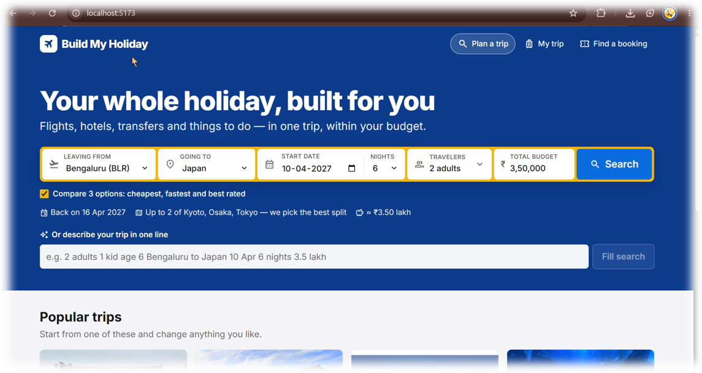
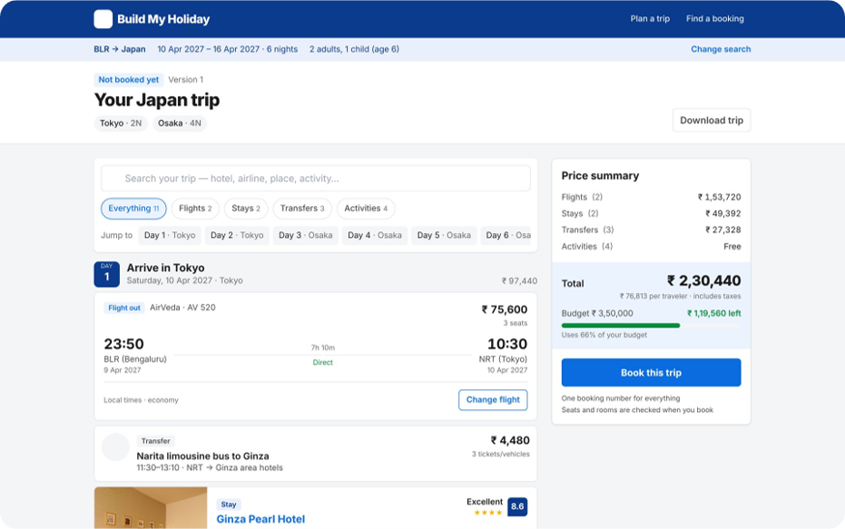
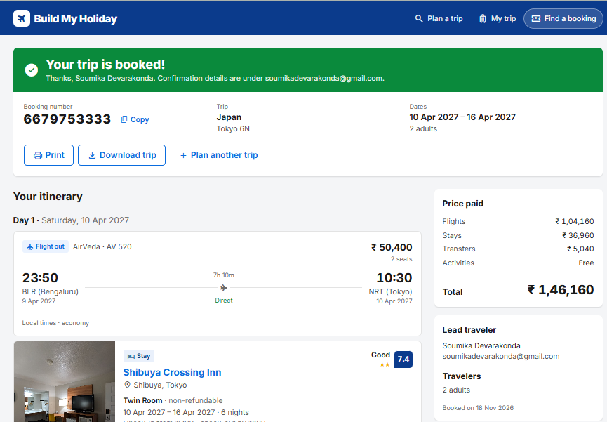
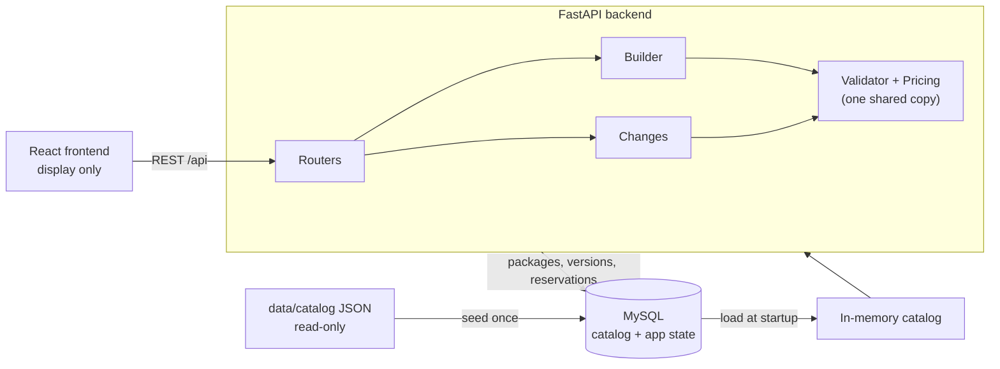

# 🌏 Build My Holiday

**Seven inputs in. One complete, rule-correct holiday package out. Re-checked after every change, then booked under a 10-digit reservation number.**

[**Live demo**](https://holiday-package-seven.vercel.app) · [Source](https://github.com/soumikadevarakonda/holiday-package) · React + TypeScript · FastAPI · MySQL 8 · **no AI inside the app**

<p align="center"></p>

## What it does

Give it a departure city, destination country, start date, nights, travelers and budget. The app **chooses the cities**, then builds flights, hotels, airport transfers, inter-city transfers and attractions into a day-by-day plan with the total and the budget left or over. Change a hotel, flight or attraction and the **whole package is re-checked**: updated, or refused with a reason. Book it to get a **10-digit booking number** that reopens the full itinerary, even after a restart.

All logic runs in the backend. The frontend only displays what the API returns.

## Screens

**1. Plan a trip.** Seven fields, with a "describe your trip in one line" box (rules, no AI) and an option to compare the cheapest, fastest and best-rated packages.


**2. Your package.** City plan, day-by-day itinerary with filters and jump-to-day, a live price summary against the budget, and a Change button on every flight, stay and activity.



**3. Booked.** A unique 10-digit booking number, the full itinerary, price paid, and print or download. Find it again any time with **Find a booking**.



## Quick start

**Prerequisites:** Git, and either Docker, or Python 3.10+, Node 18+ and MySQL 8.

```bash
git clone https://github.com/soumikadevarakonda/holiday-package.git
cd holiday-package
cp .env.example .env
docker compose up --build
```

<details>
<summary><b>Without Docker</b> (MySQL 8 already running)</summary>

```bash
# 1. Create the database and dev user (once)
mysql -u root -p < database/init/000_create_database.sql

# 2. Backend: creates a venv, installs dependencies, starts the API
#    (tables are created and the catalog is seeded on startup)
./start.sh

# 3. Frontend (second terminal)
cd frontend && npm install && npm run dev
```
</details>

App at **http://localhost:5173** · API docs at **http://localhost:8000/docs**. Defaults in `.env.example` work as is: `DB_URL` points at the local `holiday` database, and no API keys are needed. Reset state before a demo with `database/seeds/demo_reset.sql`.

**Try the Menon request:** BLR → Japan, 10 April 2027, 6 nights, 2 adults + 1 child (6), ₹3,50,000. Expect Tokyo (2 nights) and Osaka (4 nights) at ₹2,30,440, with ₹1,19,560 left.

## Features

| Level | What's included |
|---|---|
| **Must (M1–M8)** | Validated request form · package builder with "no package" reasons · every rule enforced · day-by-day plan · total, budget and JSON export · change hotel, flight, attractions · confirm and booking lookup · budget-too-small with cheapest total and a suggestion |
| **Good (G1–G4)** | Knock-on fixes and warnings · price difference on every option · change city plan · cheapest, fastest and best-rated packages |
| **Stretch (S1–S3)** | Plain-words quick request · bookings consume seats and rooms · package undo, in-trip search, photo credits |

## How it works



**City rule.** Target `max(1, floor(nights / 3))` cities, capped by the country (Japan 3, UAE 2), at least 2 nights each. Pick the cheapest valid plan within budget at that count. If none fits, try fewer cities, then one more. If nothing fits at any count, return the over-budget outcome with the cheapest package. For the Menon trip, two cities cost about 5% more than Tokyo alone for a richer trip, and the cheapest package is still offered.

**Build method: enumerate, greedy, validate.**
1. Validate the request and pre-filter flights by local date and seats.
2. Enumerate city orders × night splits (at most 135 for Japan at 10 nights).
3. Per city, pick the cheapest valid hotel, room type and room count.
4. Pick the cheapest flight pair whose transfers meet the 60 and 180-minute rules.
5. Pick inter-city transfers, then schedule attractions greedily with no overlaps.
6. Price everything, run the full validator, drop any plan that fails, then apply the city rule.

**Correctness.** Every rule from the brief is one validator check with an ID (`D`ates, `F`lights, `AT` airport transfers, `CT` city transfers, `H`otels, `A`ttractions, `P`rices), each with a passing and failing test. The builder, every change, confirm and export all run this same validator, so a change can never slip past a check the builder enforces. Time-zone, `24:00` and past-midnight edge cases live in one tested helper.

**Persistence.** Every accepted change is a new package version, so undo is free and conflicting edits are detected. Confirm re-validates, checks inventory inside one transaction, and stores a frozen `BOOKED` snapshot. Confirming twice returns the same number. A wrong number shows "not found".

## API

`POST /api/packages` · `GET /api/packages/{id}` · `GET …/options/{hotel|flight|attraction}` · `PATCH /api/packages/{id}` · `POST …/rebuild` · `POST …/undo` · `GET …/export` · `POST …/confirm` · `GET /api/reservations/{ref}` · `POST /api/parse` · `GET /api/meta`

Errors share one shape: `{code, message, details}`. The export follows the shared trip format in `data/DATA_DICTIONARY.md` §4, with `country`, hotel `room_id`, and `booking.reference` as a string once booked.

## Tests

```bash
cd backend && pytest
```

Unit tests cover one test per rule ID, pricing and city plans. An oracle test proves the fast search gives the same totals as brute force. API tests cover build, refused change, confirm, and lookup after restart. Fixtures include the Menon trip, the UAE, other departure cities, large groups, late landings, no-package and tiny-budget cases.

## Known limitations

- No login, payments or real supplier booking. Confirm saves to the app's own store.
- INR only. Flights and rooms exist only for 1–20 April 2027.
- Attraction placement is greedy, not globally optimal (the rules don't require it).
- City-plan enumeration grows as O(C⁵), fine for Japan (3 cities) and the UAE (2).
- Groups of 10 or more are rejected: no flight has more than 9 seats left.
- A change that pushes the total over budget is allowed, with a warning.

## Credits

Photo credits are in `data/images/ATTRIBUTIONS.md` and shown in the app footer. All travel data comes from the provided, unmodified `data/catalog/`.

More detail: [`PRD-Build-My-Holiday.md`](PRD-Build-My-Holiday.md) · [`PROJECT_STRUCTURE.md`](PROJECT_STRUCTURE.md) · [`database/README.md`](database/README.md)
